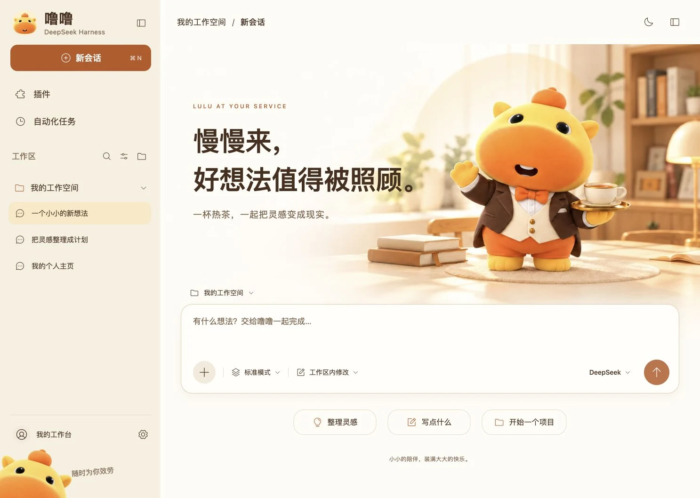

# 噜噜 · 暖橙书房 1.0

DeepSeek Harness 原生主题插件。按「暖橙书房」效果图制作：奶油色侧栏、暖橙操作、端茶的管家噜噜，以及从左下角倾斜探头的噜噜。



## 安装

在 DSH 的「插件 → 添加插件右侧箭头 → 安装第三方插件」中，把以下整行填入「包名或地址」：

```text
github:Raindmore/dsh-lulu-butler-theme#warm-study-v1
```

安装后启用 **dsh-lulu-warm-study-theme**。如果装过旧的 **dsh-lulu-butler-theme**，请先在插件列表停用旧主题，再启用本主题。

安装包已预编译，无需自己构建。同事也可以使用同一地址在自己的 DSH 中安装。仅填写插件名字不会从 npm 下载；本插件目前通过 GitHub 分发。

离线安装、关闭和卸载见 [安装说明](docs/INSTALL.md)。

## 使用

在「更多 → 设置 → 通用设置」找到「噜噜 · 暖橙书房 1.0」。可分别开关欢迎页书房、侧栏噜噜、轻柔动效或整个主题。配色跟随 DSH 原生的浅色 / 深色 / 系统外观。

- 日间为暖光书房；深色为可可夜色与暖灯。
- 欢迎页的三个快捷入口会填入提示词，保留已有草稿，由你自行发送。
- 素材嵌入插件，不依赖远程图片服务；主题设置保存在本机。
- 主题保留 DSH 的原生会话、模型、工作区、权限和附件功能。

## 开发与验证

```sh
npm ci
npm run build
npm test
npm run preview
```

打开 `http://127.0.0.1:4179/preview/index.html`。预览是交互式外观演示，没有连接模型。

已在官方 `@deepseek-ai/dsh@0.2.1-rc.2` 的隔离 Web GUI 中验证原生主题接口、提示词填入、设置、深浅色和插件停用清理。尚未在各个操作系统的打包桌面程序中逐一验证；后续 DSH 插件接口变化可能需要适配。原生侧栏宽度和系统标题栏由 DSH 管理，因此细节会随窗口及平台变化。

`lib/client.js` 是交付的原生插件；`src` 为可修改源码。`assets` 中的 WebP 是可重建的素材，原始 PNG 保留在本地源文件包。素材提示词见 `assets/*-prompt.txt`。图库由内置生图工具生成，角色基于用户提供的噜噜参考。

版本：`dsh-lulu-warm-study-theme@1.0.0`。旧版「小管家」在主分支及 `v1.0.0` 标签中保留。
