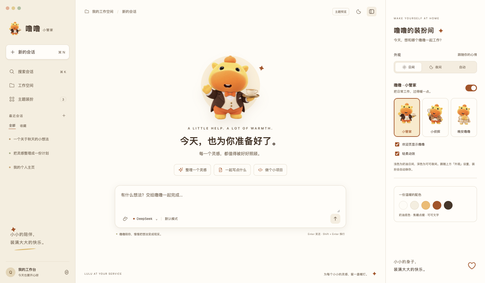
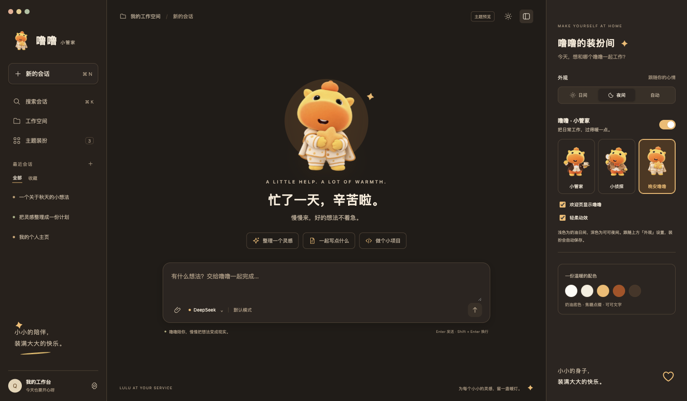

# 噜噜 · 小管家

DeepSeek Harness 暖色主题。三套可切换的噜噜装扮，配合奶油日间与可可夜间，为日常工作添一点陪伴。



## 远程安装

在 DeepSeek Harness 官方桌面版中：

1. 打开侧栏「插件」。
2. 点击「添加插件」右侧的下拉箭头，选择「安装第三方插件」。
3. 将下面这一行粘贴到「包名或地址」，点击安装：

```text
github:Raindmore/dsh-lulu-butler-theme#v1.0.0
```

4. 在「已安装插件」里启用 `dsh-lulu-butler-theme`。如界面尚未更新，重启一次 DSH。
5. 打开左下角「更多 → 设置 → 通用设置」，找到「噜噜 · 小管家」进行换装。

仓库内已提交编译好的 `lib/client.js`，安装不需要手动构建。GitHub 安装需要电脑能够访问 GitHub。

### 使用下载直链安装

也可以在「包名或地址」中填入这个预构建安装包的地址：

```text
https://raw.githubusercontent.com/Raindmore/dsh-lulu-butler-theme/main/dsh-lulu-butler-theme-1.0.0.tgz
```

若希望手动安装，可以从本仓库下载 ZIP 并解压，在 DSH 中填写解压后、包含 `package.json` 的文件夹绝对路径。

## 三套装扮

| 装扮 | 细节 |
| --- | --- |
| 小管家 | 深棕礼服、奶油马甲、橙色领结和一杯热茶 |
| 小侦探 | 驼色斗篷、放大镜，和一点好奇心 |
| 晚安噜噜 | 星星睡衣与星形抱枕，慢慢来，不着急 |

角色延续用户提供形象的圆脑袋、大橙色嘴巴、头顶小橙团和短短四肢，以内置生图工具生成透明素材。完整提示词见 [生成记录](docs/IMAGE_PROMPTS.md)。

## 配色与设置

- **奶油日间**：暖白背景、奶油黄侧栏、焦糖色按钮与深棕文字。
- **可可夜间**：可可底色、柔和琥珀色强调与暖白文字。
- 外观跟随 DSH 自带的浅色 / 深色 / 系统设置。
- 装扮和角色、动效开关保存在当前客户端，重启后保留。
- 支持操作系统的“减少动态效果”设置。
- 在通用设置中关闭主题，或在插件页停用插件，恢复原生外观。



## 兼容与验证

已在官方 `@deepseek-ai/dsh@0.2.1-rc.2` 的 Web GUI 中进行隔离安装，验证角色切换、浅深色切换、偏好保存、停用清理和重新启用。桌面版使用同一客户端插件接口；较早版本若缺少主题覆盖接口或品牌 Slot，需要另行适配。

运行时使用 DSH 自带的 React，没有额外运行时依赖。三套图片已嵌入客户端 bundle，无外部图片请求。安装包与通过原生启停测试的 bundle 保持一致。

主题通过 `ctx.theme.overrideTokens` 与原生品牌、欢迎页和设置 Slot 工作；保留 DSH 的工作区、会话、输入框、模型配置和工具行为。

## 开发与预览

```sh
npm ci
npm run build
npm test
npm run preview
```

访问 `http://127.0.0.1:4178`。也可直接用浏览器打开 `preview/index.html`。

预览页面右侧「装扮间」为本地演示控件；实际 DSH 中的装扮入口位于通用设置。预览里的对话只展示视觉样式，不连接模型。

- `src/`：插件、配色、偏好状态与样式源码。
- `lib/`：预构建的原生客户端插件。
- `assets/`：三套透明 PNG 原图与 WebP 素材。
- `preview/`：可交互的独立视觉预览。
- `dsh-lulu-butler-theme-1.0.0.tgz`：预构建安装包。

## 接口参考

- [官方主题接口](https://github.com/deepseek-ai/deepseek-harness/tree/master/packages/client/ui-theme)
- [官方客户端插件格式](https://github.com/deepseek-ai/deepseek-harness/tree/master/packages/client/modules)
- [官方插件管理](https://github.com/deepseek-ai/deepseek-harness/tree/master/packages/client/ui-plugin-manager)

这是自定义社区主题。
